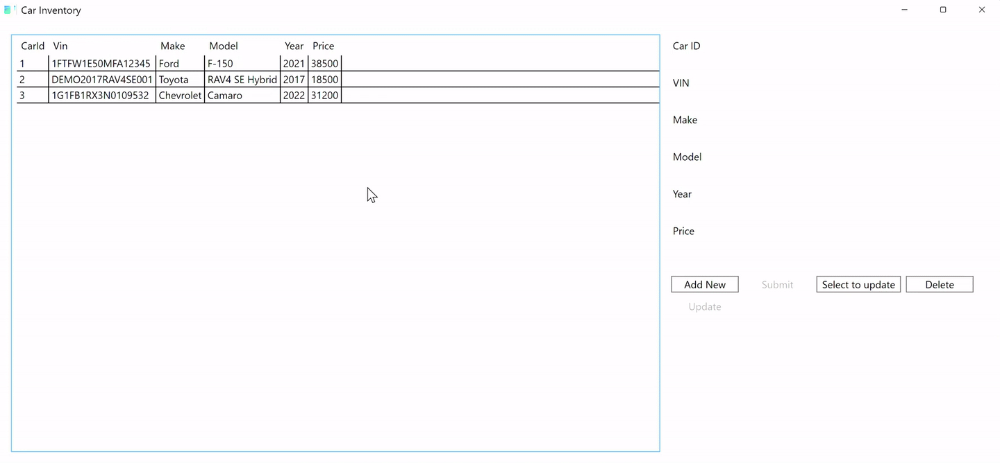

# Car Inventory

A Windows desktop app that adds, updates, and deletes car records in a SQL Server database.

I built it for Assignment 10.3 at the Microsoft Software & Systems Academy (MSSA), October 2026.

**Built with:** C#, .NET 10, WPF/XAML, Entity Framework Core, SQL Server



## What it does

- Shows every car in a grid: VIN, make, model, year, and price.
- **Add New** fills in the next ID. **Submit** saves the new car.
- **Select** loads a row into the form. **Update** saves the changes.
- **Delete** asks you to confirm, then removes the car.

## Input checks

Nothing saves until the form passes these checks:

- VIN, make, and model are not blank.
- Year is a whole number from 1900 to next year.
- Price is a number, 0 or more.

A failed check shows a message that says what to fix.

## Where to look

| Topic | File |
|---|---|
| Car class that maps to the Cars table | [Models/Car.cs](Models/Car.cs) |
| Database connection and starting data | [Data/CarContext.cs](Data/CarContext.cs) |
| Create, read, update, and delete | [Services/CRUD.cs](Services/CRUD.cs) |
| Buttons and input checks | [MainWindow.xaml.cs](MainWindow.xaml.cs) |
| Screen layout | [MainWindow.xaml](MainWindow.xaml) |

## Run it

You need Windows, the .NET 10 SDK, and SQL Server on `localhost` with Windows sign-in.

Open `Caleb_Marks_Assignment_10.3.sln` in Visual Studio and press F5, or run:

```
dotnet run --project Caleb_Marks_Assignment_10.3.csproj
```

On first start the app creates the `CCAD23CarInventory` database and adds 3 sample cars. If SQL Server is not running, the app shows a message and closes.
